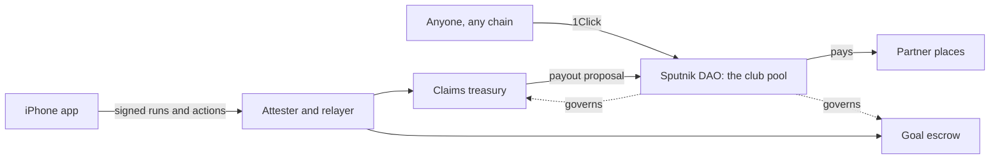

# Ije

> If you want to go fast, go alone. If you want to go far, go together.
> — African proverb

> Money is a good servant but a bad master.
> — English proverb

Ije is a run club, governed by a DAO.

Runners around the world run, meet, and share one goal: keep each other
running. The money serves the club. The club, through its DAO, decides
how it is spent.

## Try it

Public TestFlight link: <https://testflight.apple.com/join/tk76k7Ny>

> **Heads up:** Apple has not approved the build for outside testers yet,
> so the link above will not let you in until it does. Once it is
> approved, the same link works and you can join straight away.
>
> To try the app before then, email **contras.canto-3s@icloud.com** with
> the email address of your Apple account. You will be added to internal
> testing and get a TestFlight invitation.
>
> You need an iPhone on iOS 26 or later. Goals and Club do not run in the
> simulator.

## How it works

- **Run.** The app tracks your runs, counts the runners you pass, and
  coaches you. It is free and works without money or the server.
- **Set goals.** Put your own money behind a goal, like 5 km in under
  30 minutes. Run it, and the money comes back to you.
- **Prove the run.** An attester checks that the run really happened and
  signs it. The DAO chooses the attester and can vote to change it at
  any time.
- **Fund the club.** Anyone, anywhere, can give to the DAO's pool, from
  the chain they already use.
- **Claim benefits.** After a run, a runner can spend a small amount from
  the pool at a partner place near them, like a stop for water.
- **Become a member.** Your first claim makes you a member of the DAO.
  Members vote on new partner places and on how the club is run.

## How it is built



- **NEAR.** Every phone has its own NEAR account. Runners pay no gas: the
  relayer submits their signed actions.
- **Sputnik DAO** (`ije-v1.sputnik-dao.near`). Holds the club pool. Owns
  the rules: the attester, the partner list, goal limits and pausing.
- **Claims treasury.** Checks a runner's claim and asks the DAO to pay the
  partner place. Every payment is a public DAO proposal.
- **Goal escrow.** Holds goal money until a verified run unlocks it.
- **Worker** (Cloudflare). The attester and relayer. It cannot move money.
- **1Click (NEAR Intents).** Brings money in from other chains and sends
  it back out.

## Repo

| Path | What |
| --- | --- |
| `apps/ios` | The iPhone app |
| `apps/api` | The Worker |
| `contracts/treasury` | Claims treasury |
| `contracts/escrow` | Goal escrow |
| `packages` | Swift packages the app is built from |
| `design` | Specs and the record of what was built |

## Develop

```bash
cd apps/api && bun test
```

```bash
cd packages/<Name> && swift test
```

Read [`AGENT.md`](AGENT.md) before you change anything. For the full
architecture, see [`design/ARCHITECTURE.md`](design/ARCHITECTURE.md).
Everything built so far is recorded in
[`design/SYSTEM.md`](design/SYSTEM.md).
