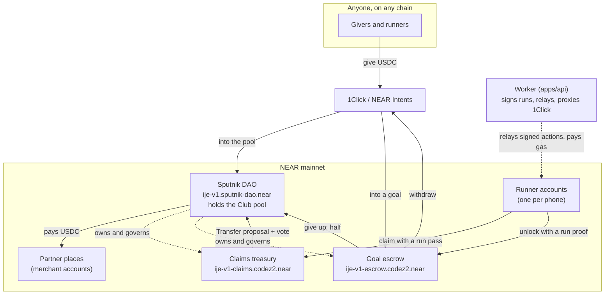
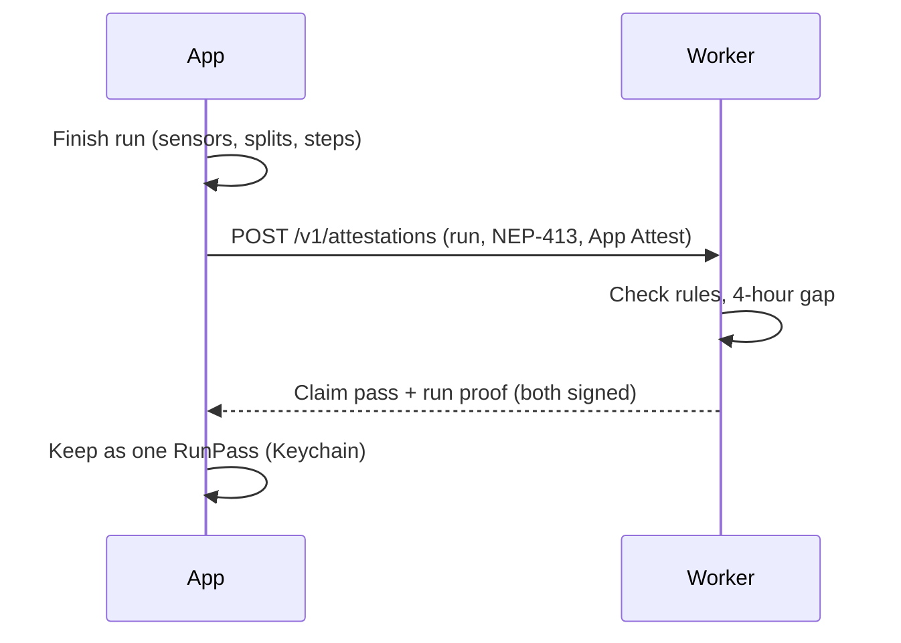
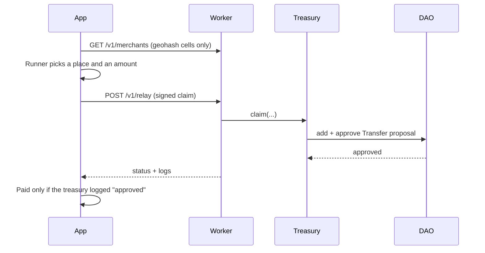

# Ije architecture

Ije is a running app for iPhone. You can use it every day for free, with
no sign-up money and no wallet to set up. It records your runs, counts
the runners you pass, and coaches you with a voice in your ear.

On top of the running app sits **social money**: money that people put
in for each other, or for themselves, and that is released by running.

- **Goals.** Put your own money behind a running goal, such as "5 km in
  under 30 minutes". Run it, and the money comes back to you.
- **Club.** A shared pool that anyone, anywhere, can give to. After a
  qualifying run, a runner can spend a small amount from the pool at a
  partner place near them, for things like water.

Social money is built on **NEAR**, and governed by a **Sputnik DAO**. The
DAO is the home of the Club pool and the owner of the rules. Runners can
join it. The money is USDC, and people pay in from the chain they already
use.

This file explains how the whole product is built. The detailed record of
every change lives in [`design/SYSTEM.md`](SYSTEM.md).

---

## 1. Rules the design follows

1. **Running never needs money or the server.** Runs, history, coaching,
   encounters and Apple Health work offline. Social money is extra.
2. **The community owns the money.** The Club pool sits in the Sputnik
   DAO. The DAO, not the company or the server, decides who gets paid
   and how the rules change.
3. **Running releases the money.** A verified run is the only key for a
   claim from the pool or for unlocking your own goal.
4. **The server cannot move money.** It checks runs and passes
   transactions along. The contracts on NEAR do the checking that
   matters.
5. **One verified run, one signature.** The server signs a finished run
   once, and both Goals and Club use that signature.
6. **Give from anywhere.** Money arrives and leaves through 1Click (NEAR
   Intents), so people can give from Base, Ethereum, Solana and more.
7. **The server keeps as little as possible.** No routes, no profiles,
   no run history, no list of who met whom.

---

## 2. Social money on NEAR and Sputnik DAO

### 2.1 The picture

### 2.2 Why NEAR

- **Accounts without setup.** Each phone makes its own NEAR account from
  a key that never leaves the phone. There is no seed phrase to write
  down and nothing to install.
- **No gas for runners.** The phone signs a *delegate action* (NEP-366).
  The Worker's relayer submits it and pays the gas. A new account gets a
  small amount of NEAR from the seeder the first time.
- **Contracts that call each other.** The treasury asks the DAO to pay,
  and the escrow asks the treasury for the attestor key, all on chain.
- **Chain abstraction.** NEAR Intents (1Click) brings USDC in from other
  chains and sends it back out, so givers never need a NEAR wallet.

### 2.3 Sputnik DAO is the centre

The DAO (`ije-v1.sputnik-dao.near`) is where social money lives and who
decides about it.

**What the DAO holds and owns**

- The **Club pool**: the DAO's own USDC balance.
- The **claims treasury**: only the DAO can add or remove partner places,
  change the attestor key, change the seeder, set the proposal bond, or
  pause claims.
- The **goal escrow**: the DAO is its owner. It sets the smallest goal
  lock and receives half of every goal that is given up.

**Roles in the DAO**

| Role | Members | What it may do |
| --- | --- | --- |
| `council` | the founding stewards | Propose and approve contract calls, such as adding a partner place (both must agree). Can reject other proposals, but cannot pass policy or member changes |
| `claims` | the claims treasury contract | Propose and approve only two things: a Transfer to a partner place, and adding a runner to `community`. Its one vote passes them |
| `community` | runners, added on their first paid claim | Propose and vote on contract calls and on the DAO's policy (3 votes needed) |

Changes to the DAO's own rules need runners in the `community` role. The
council cannot pass them alone.

**How a claim becomes a payment**

1. The runner calls the treasury with their run pass.
2. The treasury checks the pass and adds a **Transfer proposal** to the
   DAO: pay this partner place this much USDC.
3. Because the treasury holds the `claims` role, its single vote passes
   the proposal, and the DAO pays the partner place.
4. Every payment is a public DAO proposal with its own number, so anyone
   can see where the pool went.
5. If the DAO refuses, the treasury releases the pass so it can be used
   again.

**Growing the community**

A runner's first paid claim also adds a proposal to put them in the
`community` role. Spending from the pool is what makes a runner a
member, and members can then take part in how the pool is run.

### 2.4 The contracts

**Claims treasury (`contracts/treasury`)**

- `claim(attestation, signature, merchant_id, amount_cents)`, called by
  the runner. It checks:
  - the server's signature on the pass
  - the pass belongs to the caller and has not expired (2 hours)
  - the place is a registered partner
  - the amount is no more than the pass allows (up to $5)
  - the pass has not been used before
- It then adds and approves the DAO Transfer proposal, as above.
- It writes the result to its logs: `claim <nonce> approved as DAO
  proposal N`, or `released` if the DAO refused. The app reads these
  logs to know the claim was paid.

**Goal escrow (`contracts/escrow`)**

- **Lock.** USDC arrives with `ft_transfer_call` and a message:
  `{owner, goal: {distance_m, max_seconds}, funding_id}`. The escrow
  creates a lock and emits `goal_funded`.
- **Unlock.** The owner sends a run proof. The escrow checks that the run
  started after the lock and meets the goal, reads the attestor key from
  the treasury, and checks the signature. The money moves to the owner's
  balance in the escrow.
- **Give up.** Half goes back to the owner, half to the Club pool in the
  DAO.
- **Withdraw.** The owner sends their balance out to a 1Click deposit
  address that pays out on their original chain.

### 2.5 Accounts on mainnet

| Account | Role |
| --- | --- |
| `ije-v1.sputnik-dao.near` | Sputnik DAO: the Club pool and the governor of everything below |
| `ije-v1-claims.codez2.near` | Claims treasury, the DAO's `claims` member |
| `ije-v1-escrow.codez2.near` | Goal escrow, owned by the DAO |
| `ije-v1-relayer.codez2.near` | Pays gas for runners' delegate actions |
| `ije-v1-seeder.codez2.near` | Gives new runner accounts their first NEAR (set by the DAO) |
| `17208628…6133a1` | USDC on NEAR |

### 2.6 Where the other parts fit

- The **app** runs the sensors, coaching and history, holds the runner's
  NEAR key, and signs every action.
- The **Worker** checks runs and signs passes, relays signed actions,
  seeds new accounts, and talks to 1Click with the partner key.
- **1Click** is the door between other chains and NEAR.

---

## 3. What is in this repo

| Path | What it is |
| --- | --- |
| `apps/ios` | The iPhone app, its widget (Live Activity), tests and E2E tools |
| `apps/api` | The Cloudflare Worker (TypeScript, D1 database) |
| `contracts/escrow` | Goal escrow contract (Rust, NEAR) |
| `contracts/treasury` | Claims treasury contract (Rust, NEAR) |
| `packages/*` | Swift packages the app is built from (see section 4.3) |
| `packages/RunnerNear/rust` | Rust core for NEAR and 1Click, shipped to Swift through UniFFI |
| `design` | Product, API, deploy and design records |
| `tools` | Git hooks and helper scripts |

---

## 4. The iPhone app

### 4.1 How the app is put together

- **One composition root.** `AppModel` builds every long-lived service
  once (auth, gateway, NEAR, goals, club, trackers, stores) and passes
  them down.
- **View models are made lazily.** `AppViewModels` creates each feature's
  view model the first time it is needed and wires its callbacks.
- **Navigation is typed.** `RootNavigation` picks the root screen;
  `HomeNavigation` holds a typed path of destinations.
- **Each feature has the same shape:**
  `Features/<Name>/{Model, Service, ViewModel, View/{Pages, Sections, Rows}}`.
  Shared pieces live in `Shared/`.
- **Packages hold logic, the app holds UI.** Anything that does not need
  SwiftUI lives in a package with its own tests and mocks.

### 4.2 Features

| Feature | What it does |
| --- | --- |
| Launch | Asks for location and gets the app ready |
| Run ready | Home screen: pick a distance, weather, entry to Club |
| Countdown, Run live | The run itself: distance, time, pace, cadence, pause, finish; Live Activity on the lock screen |
| Run summary | Splits, cadence, encounters, Apple Health save, and the claim pass banner |
| Run history | Past runs, stored only on the phone |
| Coach (PacePilot) | Spoken cues during the run, with an on-device voice |
| Goals | Lock USDC on a goal, see progress, withdraw when you beat it |
| Club (code name `Community`) | Pool balance, partner places, claim at a place, fund the pool |

### 4.3 Swift packages

| Package | Job |
| --- | --- |
| `RunnerSession` | The workout state machine: idle, active, paused, finished |
| `RunnerLocation` | Location updates from Core Location |
| `RunnerCadence` | Steps per minute from the pedometer |
| `RunnerEncounters` | Counts runners you pass, over Bluetooth, with rotating anonymous IDs |
| `RunnerStore` | Run history and personal bests on the phone (SwiftData) |
| `RunnerHealthKit` | Saving runs to Apple Health (opt-in, runs over 0.2 km) |
| `RunnerPacePilot` | The coach: rules, a quiet cue scheduler, and a speech seam |
| `RunnerKokoro` | On-device Kokoro voice for the coach (system voice as fallback) |
| `RunnerAuth` | Sign in and the Keychain session |
| `RunnerGateway` | The only typed client for the Worker API |
| `RunnerNear` | NEAR keys, signing, RPC reads and the 1Click client (Swift + Rust) |
| `RunnerEscrow` | Goal escrow calls and views, plus the treasury `claim` call |
| `RunnerUI` | Design tokens, text styles and shared controls |

Most packages also ship a `…Testing` target with mocks.

### 4.4 The runner's account and device

- Each install makes a **NEAR implicit account**. Its private key stays in
  the phone's Keychain. The account ID is the public key in hex.
- Each install also makes an **App Attest key**. The Worker only accepts
  requests that carry a fresh assertion from a real copy of the app.
- Requests to the Worker are signed twice: by the NEAR key (NEP-413) and
  by the App Attest key. The counter inside App Attest must only go up,
  so the app sends these requests **one at a time, in order**.
- The account does not pay gas. The app signs a **delegate action**
  (NEP-366) and the Worker's relayer submits it. Before the first one,
  the Worker **seeds** the account with a little NEAR.

### 4.5 Builds and environments

| Xcode configuration | `RunnerEnvironment` | API | App Attest |
| --- | --- | --- | --- |
| Debug (Run, Test) | `dev` | local Worker (`localhost:8787`) | development |
| Staging | `staging` | the deployed Worker | production |
| Beta | `beta` | the deployed Worker | production |
| Release (Archive, TestFlight) | `prod` | the deployed Worker | production |

Goals and Club are switched off in `dev`. To try them on a phone, install
a Release build. **Archiving the `Runner` scheme always uses Release.**
TestFlight needs a new build number for every upload.

---

## 5. The server (`apps/api`)

A single Cloudflare Worker with a D1 database. Written in TypeScript;
use `bun` for install, tests and scripts.

### 5.1 Routes

| Route | Who | What it does |
| --- | --- | --- |
| `POST /v1/challenge` | App | One-time random value, valid for 5 minutes |
| `POST /v1/devices` | App | Registers the App Attest key |
| `POST /v1/attestations` | App | Checks a finished run and signs a claim pass and a run proof |
| `GET /v1/merchants?cells=` | App | Approved places in up to 9 geohash cells |
| `POST /v1/seed` | App | Gives a new runner account a little NEAR (once) |
| `POST /v1/relay` | App | Submits a signed delegate action, returns status and logs |
| `* /v1/intents/*` | App | Thin 1Click proxy: quote, tokens, status |
| `POST /v1/goals/list` | App | The runner's goals and their state |
| `POST /v1/goals/withdraw` | App | Reserves the payout for an unlocked goal |
| `/v1/merchant/*` | Merchant web portal (not in this repo) | Email sign-in, add and edit locations |
| `/v1/admin/*` | Admin | Review and approve places |

### 5.2 What the Worker checks

- **Runs.** At least 2.5 km, finished within the last 6 hours, real
  splits, pace 2:30 to 20:00 per km, cadence 100 to 230 steps a minute,
  no pause over 30 minutes. A runner (or device) gets one signed run
  every 4 hours, and runs cannot overlap.
- **Relay policy.** Only listed contract methods, with fixed deposits and
  a gas cap. Token transfers may only go to the escrow. Each account and
  device is rate limited.
- **1Click proxy.** Only `POST /v0/quote`, `GET /v0/tokens` and
  `GET /v0/status`. A paying quote to the escrow must be a correct goal
  deposit. A paying quote to the Club pool must be plain USDC on NEAR.

### 5.3 What the Worker stores

| Table | Holds |
| --- | --- |
| `devices` | App Attest public keys and counters |
| `challenges` | One-time values (deleted when used or expired) |
| `attested_activities` | Run hashes and times, for the 4-hour rule (kept 3 days) |
| `relay_log`, `seed_log` | Rate limits (relay log kept 1 hour) |
| `goals` | One saved 1Click quote per goal: origin chain and return address |
| `goal_payouts` | The reserved payout for each withdrawn goal |
| `merchants`, `locations`, `sessions`, `login_tokens` | The merchant portal |

An hourly cron job deletes expired rows.

### 5.4 Secrets

`ATTESTOR_SECRET_KEY` (signs runs), `RELAYER_SECRET_KEY`,
`SEEDER_SECRET_KEY`, `ONE_CLICK_API_KEY`, `RESEND_API_KEY` (merchant
email). They are set with `wrangler secret put` and never live in the repo.

---

## 6. Main flows

### 6.1 A run becomes a pass

The pass is valid for 2 hours and is worth up to $5, depending on the
distance. Goals use the run proof; Club uses the claim pass.

### 6.2 Lock a goal

1. The runner picks a goal, an amount, a source chain and a return address.
2. The app asks the Worker proxy for a 1Click quote. Its recipient is the
   escrow, and its message names the owner, the goal and a `funding_id`.
3. The Worker checks the quote and saves **one quote per goal**. Asking
   twice, or retrying, gives back the same quote.
4. The runner sends USDC to the deposit address. 1Click delivers it to the
   escrow, which creates the lock.
5. The goal appears on the next refresh. A lock is linked to a goal only
   when its amount matches and 1Click reports `SUCCESS`.

### 6.3 Withdraw a goal

Each step checks the chain first, so tapping Withdraw again carries on
from the step that failed:

1. **Unlock** with the run proof (the account is seeded first).
2. **Reserve the payout** on the Worker. The Worker asks 1Click for a quote
   back to the original chain and return address, and saves it once.
3. **Withdraw** from the escrow to the 1Click deposit address.

A withdrawn goal leaves the list, and the runner can lock a new one.
Goals keep no history.

### 6.4 Give to the Club pool

1. Pick an amount (a preset or your own) and a source chain: Base,
   Ethereum, Solana, Arbitrum, BNB Chain, Polygon or Sui.
2. The app asks for an EXACT_OUTPUT 1Click quote. Its recipient is the
   DAO, and refunds go to a return address on the source chain.
3. Send USDC to the deposit address. The pool receives exactly the chosen
   amount. Nothing is stored on the server.

### 6.5 Claim at a partner place

### 6.6 Add a partner place

1. The merchant signs in to the portal by email link and adds a location
   and a NEAR account.
2. The DAO votes to add that account to the treasury (`add_merchant`).
3. An admin approves the location. The Worker refuses unless the treasury
   already lists the merchant.
4. The place now shows up for runners nearby.

---

## 7. Privacy

- Routes, run history, encounters and Health data stay on the phone.
- To find places, the app sends only coarse geohash cells (about 5 km),
  never its exact position. It sorts by distance on the phone.
- Encounters use rotating anonymous Bluetooth IDs. Only counts are kept.
- The server keeps run hashes and times for 3 days, only to enforce the
  4-hour rule.

---

## 8. Working on the project

| Task | Command |
| --- | --- |
| Worker tests | `cd apps/api && bun test` |
| Worker types | `cd apps/api && bun run typecheck` |
| Deploy Worker | `cd apps/api && bun run deploy` |
| Apply D1 migrations | `cd apps/api && bun run migrate:remote` |
| A package's tests | `cd packages/<Name> && swift test` |
| App tests | `xcodebuild test -project apps/ios/Runner.xcodeproj -scheme Runner -destination '<simulator>'` |
| Rebuild the Rust core | `packages/RunnerNear/rust/build-xcframework.sh` |
| Format Swift | `swift format -i <files>` |

House rules (full list in [`AGENT.md`](../AGENT.md)):

- Talk through how a change looks and behaves before building it.
- Add an entry to `design/SYSTEM.md` for every finished piece of work.
- Use `bun`, not npm. Use Swift 6 and iOS 26 or later.
- Run `swift format` before pushing. A pre-push hook checks it. Never
  push with `--no-verify`.

---

## 9. More reading

| Doc | About |
| --- | --- |
| [`design/product.md`](product.md) | The full product idea and feature list |
| [`design/ORDER.md`](ORDER.md) | Agreed specs, item by item |
| [`design/API.md`](API.md) | Worker API details and decisions |
| [`design/SERVER-SCOPE.md`](SERVER-SCOPE.md) | What the server may and may not do |
| [`design/DEPLOY.md`](DEPLOY.md) | Contract and Worker deployment order |
| [`design/E2E.md`](E2E.md) | End-to-end testing |
| [`design/SYSTEM.md`](SYSTEM.md) | Record of everything built, and why |
